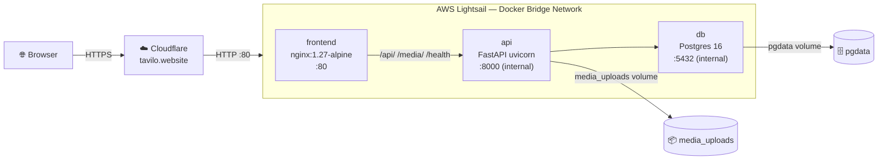

# Tavilo — Docker & Deployment Guide

> [!IMPORTANT]
> All secret files (`backend/.env.production`, `.env.server`) are **git-ignored**. You must create them manually on the server before first deploy.

---

## Architecture



**Request flow:**
1. Browser → Cloudflare (HTTPS/443) — Cloudflare terminates TLS
2. Cloudflare → Lightsail port 80 (plain HTTP) — with `CF-Connecting-IP` header
3. nginx container → routes `/api/*` and `/media/*` → `api:8000` (internal Docker DNS)
4. All other requests → React SPA (`index.html`)

---

## Local Development

### Prerequisites
- Docker Desktop with Compose v2

### Steps

```bash
# 1. Clone
git clone <repo-url>
cd tavilo

# 2. Create local backend env (copy from example and edit)
cp backend/.env.production backend/.env   # then fill in real dev values

# 3. Create .env.server for local DB creds
cat > .env.server <<'EOF'
DB_USER=tavilo_user
DB_PASSWORD=localpassword
DB_NAME=tavilo_dev
EOF

# 4. Start everything (compose.override.yml is picked up automatically)
docker compose up

# Access:
#   Frontend Vite dev server: http://localhost:5173
#   FastAPI with hot-reload:  http://localhost:8000
#   Postgres:                 localhost:5432
```

> [!TIP]
> The override file mounts `./backend` and `./frontend` as volumes so code changes reflect instantly without rebuilding.

---

## Production Setup on AWS Lightsail

### Step 1 — SSH into the server

```bash
ssh -i ~/.ssh/lightsail-key.pem ubuntu@13.201.122.25
```

### Step 2 — Install Docker & Docker Compose

```bash
# Update packages
sudo apt-get update && sudo apt-get upgrade -y

# Install Docker
curl -fsSL https://get.docker.com | sudo sh
sudo usermod -aG docker $USER
newgrp docker

# Verify
docker --version
docker compose version   # must be v2.x
```

### Step 3 — Clone the repository

```bash
sudo mkdir -p /opt/tavilo
sudo chown $USER:$USER /opt/tavilo
git clone <your-repo-url> /opt/tavilo
cd /opt/tavilo
```

### Step 4 — Populate secret files

#### `.env.server` (DB credentials)
```bash
cat > /opt/tavilo/.env.server <<'EOF'
DB_USER=tavilo_user
DB_PASSWORD=<strong-random-password>
DB_NAME=tavilo_prod
EOF
chmod 600 /opt/tavilo/.env.server
```

#### `backend/.env.production`
```bash
# Generate secrets first
python3 -c "import secrets; print(secrets.token_hex(32))"  # → JWT_SECRET
python3 -c "import secrets; print(secrets.token_urlsafe(24))"  # → ADMIN_BOOTSTRAP_PASSWORD

nano /opt/tavilo/backend/.env.production
# Fill in all CHANGE_ME values
chmod 600 /opt/tavilo/backend/.env.production
```

> [!CAUTION]
> Never use weak passwords. `JWT_SECRET` must be at least 32 random characters. Use the `secrets` commands above.

### Step 5 — First deploy

```bash
cd /opt/tavilo

# Load DB env for compose
set -a && source .env.server && set +a

# Build and start all services
docker compose up -d --build

# Run migrations once DB is healthy
docker compose exec api alembic upgrade head

# Check everything is running
docker compose ps
```

### Step 6 — Verify

```bash
curl http://localhost/health        # should return {"status":"ok"}
curl http://localhost/api/v1/...    # your API endpoints
```

---

## Cloudflare DNS & SSL Setup

### DNS Records (in Cloudflare dashboard)

| Type | Name | Content | Proxy |
|------|------|---------|-------|
| A | `@` (tavilo.website) | `13.201.122.25` | ✅ ON |
| A | `www` | `13.201.122.25` | ✅ ON |

### SSL/TLS Settings

1. Go to **SSL/TLS** → **Overview**
2. Set mode to **Full (strict)**

> [!NOTE]
> With Cloudflare in **Full (strict)** mode, the browser sees HTTPS, so `COOKIE_SECURE=true` works correctly even though traffic between Cloudflare and your server is plain HTTP on port 80. Your nginx container does **not** need to handle TLS.

### Page Rules (optional but recommended)

- `http://tavilo.website/*` → **Always Use HTTPS**
- `http://www.tavilo.website/*` → **Always Use HTTPS**

---

## Continuous Deployment

### Using `deploy.sh`

```bash
# On the server, make it executable once:
chmod +x /opt/tavilo/deploy.sh

# Then deploy any time:
/opt/tavilo/deploy.sh
```

The script:
1. Pulls latest code from `main`
2. Rebuilds Docker images (with `--pull` to get base image updates)
3. Restarts containers with zero-downtime rolling update
4. Waits for API health check to pass
5. Runs Alembic migrations automatically
6. Prunes dangling images

### Automating with GitHub Actions (optional)

```yaml
# .github/workflows/deploy.yml
name: Deploy
on:
  push:
    branches: [main]
jobs:
  deploy:
    runs-on: ubuntu-latest
    steps:
      - name: SSH Deploy
        uses: appleboy/ssh-action@v1
        with:
          host: 13.201.122.25
          username: ubuntu
          key: ${{ secrets.LIGHTSAIL_SSH_KEY }}
          script: /opt/tavilo/deploy.sh
```

---

## Useful Operations

### View logs

```bash
# All services
docker compose logs -f

# Specific service
docker compose logs -f api
docker compose logs -f frontend
docker compose logs -f db
```

### Restart a single service

```bash
docker compose restart api
```

### Connect to Postgres shell

```bash
source /opt/tavilo/.env.server
docker compose exec db psql -U $DB_USER -d $DB_NAME
```

### Run a one-off migration

```bash
docker compose exec api alembic upgrade head
docker compose exec api alembic history
docker compose exec api alembic current
```

### Open a Python shell inside the API container

```bash
docker compose exec api python -c "from src.database import engine; print(engine)"
```

### Backup the database

```bash
source /opt/tavilo/.env.server
docker compose exec db pg_dump -U $DB_USER $DB_NAME | gzip > tavilo_backup_$(date +%Y%m%d_%H%M%S).sql.gz
```

### Restore a backup

```bash
source /opt/tavilo/.env.server
gunzip -c tavilo_backup_YYYYMMDD_HHMMSS.sql.gz | docker compose exec -T db psql -U $DB_USER -d $DB_NAME
```

### Inspect the uploads volume

```bash
docker volume inspect tavilo_media_uploads
docker compose exec api ls -la /app/uploads/products/
```

### Scale the API (if needed in future)

```bash
docker compose up -d --scale api=3
# Note: requires a load balancer in front; update nginx upstream accordingly
```

---

## Adding a New Feature / Service

### New environment variable

1. Add to `backend/.env.production` on the server
2. Add to `backend/src/config.py` Settings class
3. Add placeholder to `backend/.env.production` in the repo (with `CHANGE_ME`)
4. Run `deploy.sh`

### New Docker service (e.g., Redis)

```yaml
# docker-compose.yml — add under services:
  redis:
    image: redis:7-alpine
    restart: always
    networks:
      - tavilo_network
    volumes:
      - redis_data:/data
    healthcheck:
      test: ["CMD", "redis-cli", "ping"]
      interval: 10s
      timeout: 5s
      retries: 3

# Add to volumes section:
volumes:
  redis_data:
```

---

## Volume & Data Persistence

| Volume | Contents | Backup strategy |
|--------|----------|-----------------|
| `pgdata` | All PostgreSQL data | pg_dump to S3 |
| `media_uploads` | Product images | Sync to S3 with `aws s3 sync` |

> [!TIP]
> Future enhancement: add a cron job or Lambda to sync `media_uploads` volume to the S3 bucket for redundancy and CDN delivery.

---

## Security Checklist

- [x] API container has **no** exposed ports — only nginx faces the internet
- [x] DB container has **no** exposed ports in production
- [x] All containers run on an **isolated bridge network** (`tavilo_network`)
- [x] Backend runs as non-root user `appuser` (UID 1001)
- [x] Secret files (`*.env.production`, `.env.server`) are git-ignored
- [x] nginx denies access to hidden files (`.env`, `.git`, etc.)
- [x] Security headers set: `X-Frame-Options`, `X-Content-Type-Options`, `X-XSS-Protection`, `Referrer-Policy`
- [x] `COOKIE_SECURE=true` + Cloudflare Full SSL = cookies always transmitted over HTTPS
- [x] `TRUSTED_HOSTS` explicitly lists allowed hostnames — no wildcard `*`
- [x] `CORS_ORIGINS` explicitly lists allowed origins — no wildcard `*`
- [ ] TODO: Enable Cloudflare WAF rules (OWASP ruleset)
- [ ] TODO: Set up Fail2ban or Cloudflare rate limiting for `/api/v1/auth/`
- [ ] TODO: Add S3 automated DB backup cron

---

## File Map

```
tavilo/
├── backend/
│   ├── Dockerfile              # Multi-stage Python 3.12 build
│   ├── .dockerignore
│   ├── .env.production         # ⚠ git-ignored, fill before deploy
│   ├── src/                    # FastAPI application
│   ├── migrations/             # Alembic migration files
│   └── alembic.ini
├── frontend/
│   ├── Dockerfile              # Multi-stage node→nginx build
│   ├── .dockerignore
│   ├── nginx.conf              # SPA + reverse-proxy config
│   └── src/                    # React + Vite source
├── docker-compose.yml          # Production services
├── docker-compose.override.yml # Local dev overrides (auto-applied)
├── .env.server                 # ⚠ git-ignored, DB creds for compose
├── deploy.sh                   # Production deploy script
└── .gitignore
```
