<div align="center">


<br/>


### A production-grade multi-vendor marketplace — built to never oversell, never double-charge, never leak a session.

<br/>

[](https://www.python.org/)
[](https://fastapi.tiangolo.com/)
[](https://www.postgresql.org/)
[](https://react.dev/)
[](https://vitejs.dev/)
[](https://tailwindcss.com/)
[](https://www.docker.com/)
[](https://nginx.org/)


<br/>

**[🧭 Concept](#concept) · [🏗️ Architecture](#architecture) · [🔄 Workflows](#workflows) · [🗄️ Data](#data) · [🔐 Security](#security) · [📡 API](#api) · [🚀 Quick start](#quick-start) · [🛰️ Deploy](#deploy) · [🗺️ Roadmap](#roadmap)**

<sub>💡 Hover any badge for a tooltip · click any ▸ section to expand it · diagrams are animated SVG and Mermaid, rendered natively by GitHub</sub>

</div>

---

<a id="concept"></a>

## 🧭 The idea in 30 seconds

Most small shops sell from **one** store. A marketplace sells from **many** — and that is where things break: carts that mix sellers, stock that two buyers grab at once, orders that one seller can cancel while another already shipped.

**Tavilo solves that with one rule: _one cart for the customer, one sub-order per store._**

<div align="center">
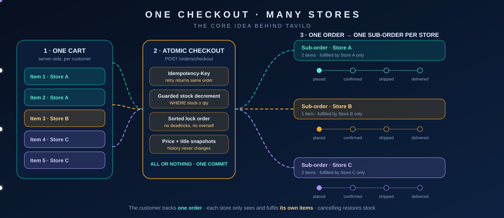
</div>

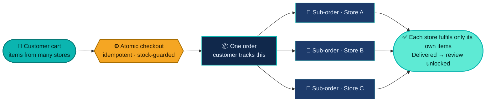

### One codebase · three experiences

| | Role | What they can do |
|:-:|---|---|
| 🛍️ | **Customer** | Search, filter and sort a paginated catalogue · server-side cart and wishlist · saved addresses · multi-store checkout (cash on delivery or demo online payment) · track and cancel orders · leave a review once an order is delivered |
| 🏪 | **Vendor** | Apply for a store · manage products with multi-image upload · publish service offerings · edit the public store page · fulfil own sub-orders `placed → confirmed → shipped → delivered`, or cancel before shipping |
| 🛡️ | **Admin** | Platform stats · approve or suspend vendors · change user roles · manage a two-level category tree · every sensitive action lands in an **audit log** |

---

<a id="architecture"></a>

## 🏗️ System architecture

<div align="center">
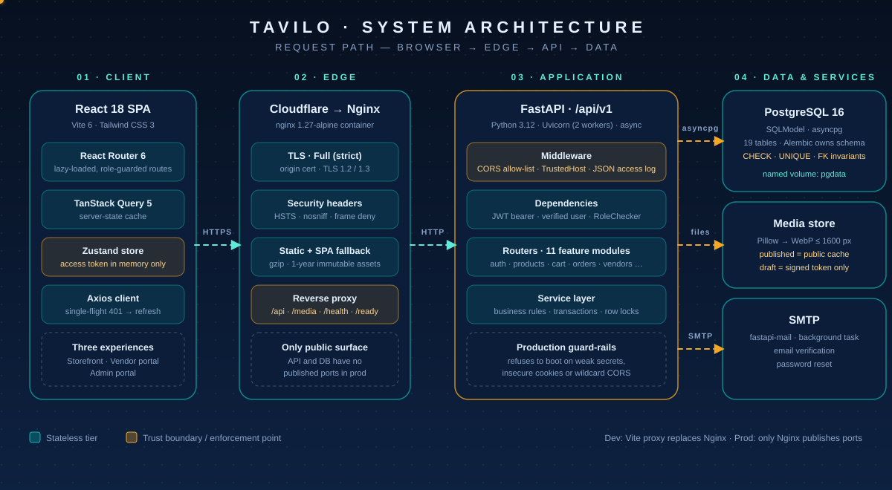
</div>

<br/>

<details>
<summary><b>▸ Life of a request</b> — what happens between a click and a response</summary>

<br/>

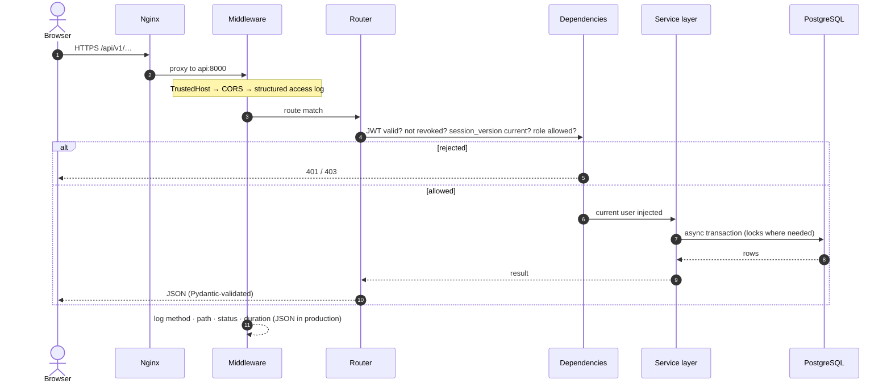

</details>

<details>
<summary><b>▸ Backend anatomy</b> — every feature is a self-contained module</summary>

<br/>

```text
backend/src/<feature>/
├── routes.py     HTTP layer: paths, dependencies, status codes
├── schemas.py    Pydantic request / response contracts
└── service.py    business rules, transactions, database access
```

| Module | Responsibility |
|---|---|
| `auth` | Signup → verify → login → refresh → logout, password reset, role guards |
| `products` · `categories` | Catalogue, filtering, image upload and gated delivery · nested categories |
| `vendors` · `services` | Store applications and profiles · vendor service offerings |
| `cart` · `wishlist` · `addresses` | Per-user shopping state |
| `orders` | Atomic checkout, cancellation, vendor fulfilment |
| `reviews` | Verified-purchase ratings with aggregate recompute |
| `admin` | Platform stats, user roles |
| `audit.py` · `mail.py` · `middleware.py` · `errors.py` · `config.py` | Cross-cutting concerns |

</details>

<details>
<summary><b>▸ Frontend anatomy</b> — session restore, guarded routes, silent refresh</summary>

<br/>

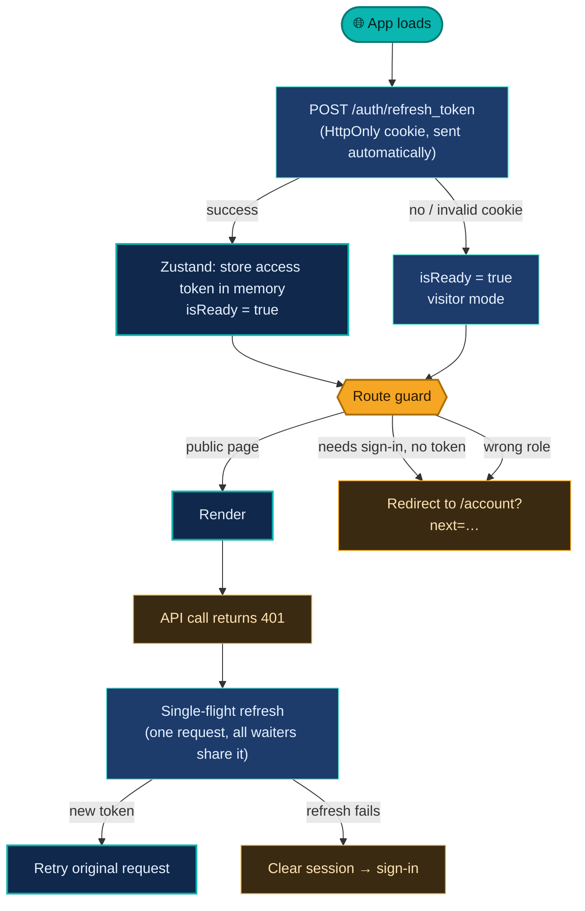

12 lazy-loaded page modules · React Router 6 · TanStack Query for server state · Zustand for the in-memory token · a global top-bar request indicator.

</details>

---

<a id="workflows"></a>

## 🔄 Full workflows

Every important journey, end to end. Click to open the one you care about.

<details open>
<summary><b>▸ 1 · Sign-up with verify-then-create</b></summary>

<br/>

A user row is created **only after** the email link is confirmed. Until then the signup lives in a separate `pending_registrations` table.

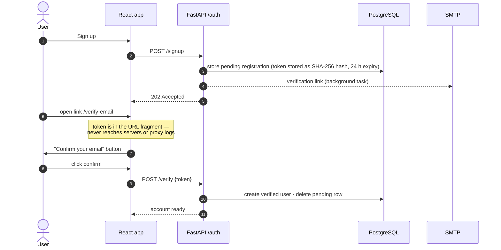

> 🛡️ **Scanner-proof by design.** Corporate email scanners that "click" links cannot burn the token: it sits in the fragment, and the browser must explicitly confirm.

</details>

<details>
<summary><b>▸ 2 · Login, silent refresh and logout</b></summary>

<br/>

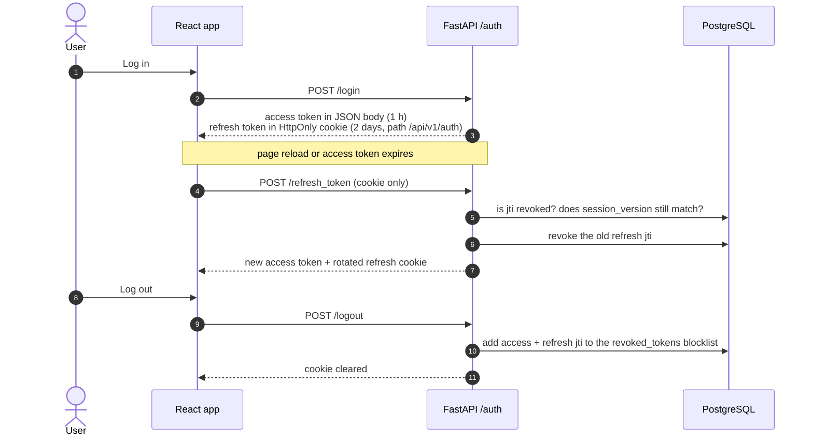

| Defence | Effect |
|---|---|
| **Rotating refresh tokens** | A stolen refresh token works once, at most |
| **`jti` blocklist** | Logout truly logs out — tokens are dead server-side, not just forgotten |
| **`session_version` claim** | Bumping it (password reset, role change) invalidates every live session instantly |
| **Token in memory** | Nothing sensitive in `localStorage`, nothing for XSS to read |

</details>

<details open>
<summary><b>▸ 3 · Concurrency-safe checkout</b> — the heart of the system</summary>

<br/>

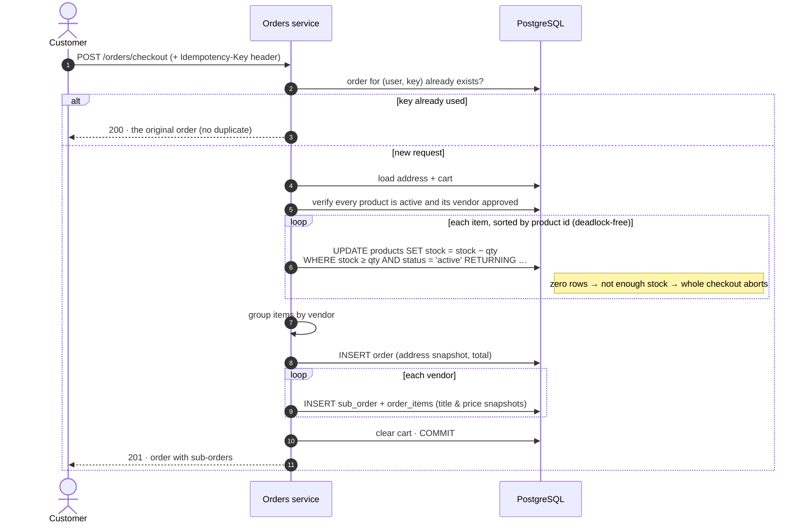

**Why it can't oversell:** the stock check *is* the update — one atomic statement per product, so two buyers racing for the last unit cannot both win. A database `CHECK (stock >= 0)` is the final backstop.
**Why it can't double-charge:** a retry with the same `Idempotency-Key` returns the original order. A `UNIQUE (user_id, idempotency_key)` index enforces it even under a race.

</details>

<details>
<summary><b>▸ 4 · Sub-order lifecycle & cancellation</b></summary>

<br/>

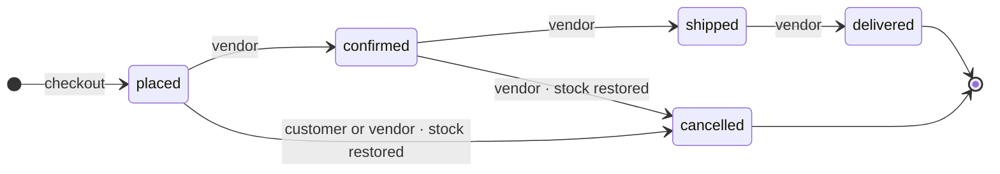

- The parent order's status is **derived** from its sub-orders.
- A customer may cancel only while **every** sub-order is still `placed`.
- Cancel and status changes take `SELECT … FOR UPDATE` locks (order → sub-orders → products), so a customer and a vendor can never race each other.
- Cancelling an `online_mock` order marks the payment `refunded`.
- Delivery of a sub-order is what unlocks reviews for that product.

</details>

<details>
<summary><b>▸ 5 · Vendor onboarding</b></summary>

<br/>

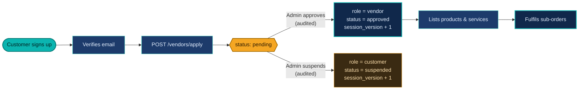

The role change and the vendor status are updated under one row lock, and a deferred database constraint enforces the same invariant for *every* writer — even a hand-written SQL job.

</details>

<details>
<summary><b>▸ 6 · Product image pipeline</b> — gated delivery, not a public folder</summary>

<br/>

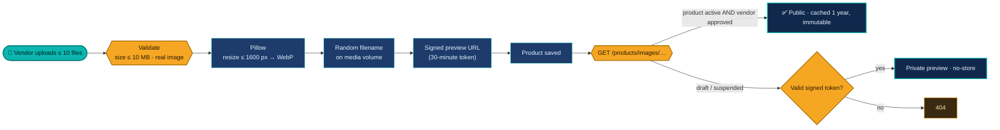

Non-image uploads are rejected, filenames are random and path-traversal-checked, and the upload directory is **never** mounted as a public static folder.

</details>

<details>
<summary><b>▸ 7 · Zero-friction deploy</b> — one script, health-gated</summary>

<br/>

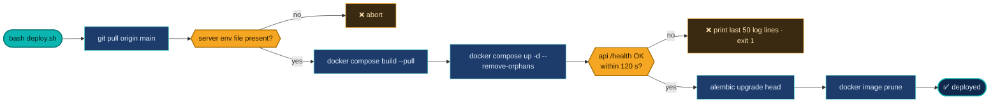

</details>

---

## ⚡ Engineering highlights

| | Capability | How it works |
|:-:|---|---|
| 🔒 | **Concurrency-safe stock** | Guarded `UPDATE … WHERE stock >= :qty AND status = 'active' RETURNING …`, applied in sorted product order to avoid deadlocks; `CHECK (stock >= 0)` as backstop |
| ♻️ | **Idempotent checkout** | `Idempotency-Key` + unique `(user_id, idempotency_key)`; a retry returns the original order (`200`) instead of creating a duplicate (`201`) |
| 🧱 | **Row-level locking** | `SELECT … FOR UPDATE` on order → sub-orders → products so cancels and vendor status changes cannot race |
| 📦 | **Stock restoration** | Automatic on customer cancel and on vendor cancel of a `placed` / `confirmed` sub-order |
| 📧 | **Verify-then-create signup** | Real `users` row only after email confirmation; tokens are random, stored as **SHA-256 hashes**, expire in 24 h, single-use |
| 🛡️ | **Scanner-proof links** | Token travels in the URL **fragment**, so it never reaches server or proxy logs |
| 🔁 | **Rotating refresh tokens** | `HttpOnly` cookie scoped to `/api/v1/auth`; every refresh revokes the old `jti` |
| 🧬 | **Mass session invalidation** | `users.session_version` is embedded in every JWT — bump it and all sessions die |
| 🖼️ | **Gated image delivery** | WebP re-encode, ≤ 1600 px; published images are public-cacheable, drafts need a short-lived signed token |
| ⭐ | **Verified-purchase reviews** | Only buyers with a **delivered** sub-order can review; one review per product |
| 📝 | **Audit trail** | `audit_logs` records admin logins, role changes and vendor decisions with actor and target |
| 🩺 | **Operability** | `/health` liveness · `/ready` DB-backed readiness · JSON logs in production · container healthchecks |

---

<a id="data"></a>

## 🗄️ Data model

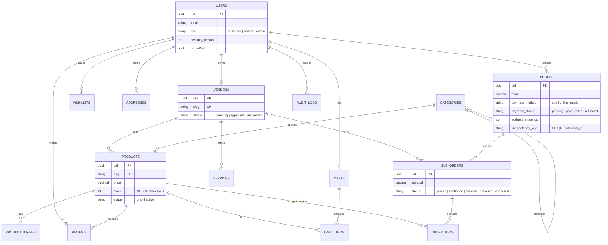

<details>
<summary><b>▸ All 19 tables</b></summary>

<br/>

| Domain | Table | Purpose |
|---|---|---|
| **Identity** | `users` | Accounts, CHECK-constrained `role`, `session_version`, `is_verified` |
| | `pending_registrations` | Signups awaiting email verification (hashed token, expiry, resend cooldown) |
| | `password_reset_tokens` | One-time reset credentials (digest only), expiry, `used_at` |
| | `revoked_tokens` | JWT `jti` blocklist |
| | `audit_logs` | Record of security-sensitive actions |
| **Marketplace** | `vendors` | Store profile, unique slug, approval status, 1:1 with a user |
| | `categories` | Two-level self-referential tree |
| | `products` · `product_images` | Price, stock, status, rating aggregate · ordered images |
| | `services` · `service_images` | Vendor service offerings |
| **Shopping** | `carts` · `cart_items` | Server-side cart per user |
| | `wishlists` · `addresses` | Saved products · shipping addresses |
| **Orders** | `orders` | Parent order: total, payment, address snapshot, idempotency key |
| | `sub_orders` | One per vendor per order, with its own status and subtotal |
| | `order_items` | Line items with title and price **snapshots** |
| **Trust** | `reviews` | Rating 1–5, text, verified-purchase flag |

Schema history lives in `backend/migrations/versions/` — 20 Alembic revisions covering the security audit, order concurrency safety, pending registrations, the marketplace schema and review-integrity repairs. `backend/scripts/` holds helpers to inspect and repair a live database.

</details>

---

<a id="security"></a>

## 🔐 Security model

| Layer | Control |
|---|---|
| **Passwords** | bcrypt hashes · reset requests never reveal whether an email exists · reset links expire in 30 minutes |
| **Sessions** | 1 h access JWT held in memory · 2-day rotating `HttpOnly` refresh cookie · `jti` blocklist · `session_version` kill-switch |
| **One-time links** | Random tokens, stored only as SHA-256 hashes, expiring, single-use, resend cooldown |
| **Authorization** | Verified-account + role dependencies (`customer` / `vendor` / `admin`) on every protected route; ownership checks on vendor resources |
| **Transport** | HTTPS end to end (Cloudflare Full-strict → origin certificate), TLS 1.2/1.3, HSTS, `X-Frame-Options: DENY`, `nosniff`, strict referrer policy |
| **API perimeter** | CORS allow-list with credentials · `TrustedHostMiddleware` · hidden files denied at the proxy |
| **Fail-closed config** | With `APP_ENV=production` the app **refuses to start** if the JWT secret is under 32 characters, cookies are not `Secure`, the frontend URL is not HTTPS, or CORS / trusted hosts contain `*` |
| **Uploads** | Count and size limits · image re-encoded to WebP · random filenames · no public directory · signed previews for drafts |
| **Data integrity** | CHECK, UNIQUE and foreign-key constraints in the database itself — not only in Python |
| **Containers** | Backend runs as a **non-root** user · multi-stage images · API and database are not published to the host in production |
| **Secrets** | Never committed: server and backend env files are git-ignored and loaded at runtime |
| **Auditability** | Admin logins, role changes and vendor decisions are recorded |

---

## 🧰 Tech stack

<div align="center">

| Layer | Technology |
|---|---|
| **Backend** | Python 3.12 · FastAPI · SQLModel / SQLAlchemy (async) · asyncpg · Alembic · Pydantic Settings |
| **Auth** | PyJWT · passlib + bcrypt · itsdangerous (signed image tokens) |
| **Email** | fastapi-mail (SMTP) with background delivery |
| **Media** | Pillow — validate, resize, convert to WebP |
| **Database** | PostgreSQL 16 |
| **Frontend** | React 18 · Vite 6 · React Router 6 · Tailwind CSS 3 · TanStack Query 5 · Zustand 5 · React Hook Form · Axios · lucide-react |
| **Delivery** | Docker Compose · multi-stage images · Nginx 1.27 · Cloudflare in front |

</div>

---

<a id="api"></a>

## 📡 API reference

Interactive docs once the API is running: **`/api/v1/docs`** (Swagger UI) · **`/api/v1/redoc`**.
Paths below are prefixed with `/api/v1`. Access legend: 🌍 public · 👤 verified user · 🏪 vendor · 🛡️ admin.

<details>
<summary><b>▸ Auth</b> · <code>/auth</code> — 10 routes</summary>

<br/>

| Method | Path | Access | Description |
|---|---|:-:|---|
| POST | `/signup` | 🌍 | Create a pending registration and send the verification email (`202`) |
| POST | `/verify` | 🌍 | Confirm the token and create the account |
| POST | `/resend-verification` | 🌍 | Resend the link (60 s cooldown, generic response) |
| POST | `/login` | 🌍 | Access token in body, refresh token in `HttpOnly` cookie |
| POST | `/refresh_token` | 🌍 (cookie) | Rotate the refresh token and issue a new access token |
| POST | `/logout` | 👤 | Revoke tokens and clear the cookie |
| GET | `/me` | 👤 | Current user |
| POST | `/password-reset-request` | 🌍 | Request a reset email (never reveals if the email exists) |
| POST | `/password-reset-confirm` | 🌍 | Set a new password with the emailed token |
| POST | `/send_email` | 🛡️ | Send an email |

</details>

<details>
<summary><b>▸ Catalogue</b> · products · categories · services · reviews</summary>

<br/>

| Method | Path | Access | Description |
|---|---|:-:|---|
| GET | `/products` | 🌍 | Filters `q` `category` `vendor` `min_price` `max_price` `in_stock` · `sort` · `page` · `page_size` |
| GET | `/products/slug/{slug}` | 🌍 | Product detail |
| GET | `/products/images/{filename}` | 🌍* | Published images public; drafts need a signed `?token=` |
| GET | `/products/vendor/me` | 🏪 | Own products |
| POST | `/products/vendor/me/images` | 🏪 | Upload up to 10 images, 10 MB each |
| POST | `/products/vendor/me` | 🏪 | Create a product |
| PATCH · DELETE | `/products/vendor/me/{uid}` | 🏪 | Update / delete own product |
| GET | `/categories` · `/categories/{slug}` | 🌍 | Category tree / one category |
| POST · PATCH · DELETE | `/categories` · `/categories/{uid}` | 🛡️ | Manage categories |
| GET | `/services` | 🌍 | Service offerings |
| GET · POST | `/services/vendor/me` | 🏪 | List / create own services |
| PATCH · DELETE | `/services/vendor/me/{uid}` | 🏪 | Update / delete own service |
| GET | `/products/{slug}/reviews` | 🌍 | List reviews |
| GET | `/products/{slug}/review-status` | 👤 | May I review this? Have I already? |
| POST | `/products/{product_id}/reviews` | 👤 | Create a review (delivered purchase required) |
| PUT · DELETE | `/products/{product_id}/reviews/{review_id}` | 👤 | Edit / delete own review |

</details>

<details>
<summary><b>▸ Shopping</b> · cart · wishlist · addresses · orders</summary>

<br/>

| Method | Path | Access | Description |
|---|---|:-:|---|
| GET · POST | `/cart` | 👤 | View cart / add item |
| PATCH · DELETE | `/cart/{item_uid}` | 👤 | Change quantity / remove |
| GET · POST | `/wishlist` | 👤 | List / add |
| DELETE | `/wishlist/{product_id}` | 👤 | Remove |
| GET · POST | `/addresses` | 👤 | List / create |
| PATCH · DELETE | `/addresses/{uid}` | 👤 | Update / delete |
| POST | `/orders/checkout` | 👤 | Place an order — honours `Idempotency-Key` (`201` new · `200` replay) |
| GET | `/orders` · `/orders/{uid}` | 👤 | History / detail with sub-orders |
| POST | `/orders/{uid}/cancel` | 👤 | Cancel while every sub-order is `placed` |
| GET | `/orders/vendor` | 🏪 | The vendor's incoming sub-orders |
| PATCH | `/orders/vendor/sub-orders/{sub_uid}/status` | 🏪 | Advance or cancel a sub-order |

</details>

<details>
<summary><b>▸ Vendors, admin & operations</b></summary>

<br/>

| Method | Path | Access | Description |
|---|---|:-:|---|
| POST | `/vendors/apply` | 👤 | Apply for a store |
| GET · PATCH | `/vendors/me/profile` | 🏪 | Own store profile |
| GET | `/vendors/{slug}` | 🌍 | Public store page |
| GET | `/vendors/admin/pending` | 🛡️ | Pending applications |
| PATCH | `/vendors/admin/{uid}/approve` · `/suspend` | 🛡️ | Decide an application (audited) |
| GET | `/admin/stats` | 🛡️ | Users, vendors, products, orders, revenue |
| GET | `/admin/users` | 🛡️ | All users |
| PATCH | `/admin/users/{uid}/role` | 🛡️ | Change a role (audited) |
| GET | `/health` (no prefix) | 🌍 | Liveness |
| GET | `/ready` (no prefix) | 🌍 | Readiness — `503` if the database is unreachable |

</details>

**Example — idempotent checkout**

```bash
curl -X POST http://localhost:8000/api/v1/orders/checkout \
  -H "Authorization: Bearer $ACCESS_TOKEN" \
  -H "Idempotency-Key: $(uuidgen)" \
  -H "Content-Type: application/json" \
  -d '{"address_id": "<address-uid>", "payment_method": "cod"}'
# 201 → order created.   Repeat the exact same call with the same key → 200 + the original order.
```

---

<a id="quick-start"></a>

## 🚀 Quick start

**You need:** Docker with Compose v2 — *or* Python 3.12 + [`uv`](https://docs.astral.sh/uv/), Node.js 22, PostgreSQL 16 — and an SMTP account for verification emails.

### Option A · Docker (everything in one command)

```bash
git clone https://github.com/<your-username>/Tavilo-eCommerce.git && cd Tavilo-eCommerce

# 1 · database credentials for Compose (local only — pick your own values)
cat > .env.server <<'EOF'
DB_USER=<db-user>
DB_PASSWORD=<db-password>
DB_NAME=<db-name>
EOF

# 2 · backend settings — create backend/.env  (see "Configuration" below)

# 3 · start Postgres + API (hot reload) + Vite dev server
docker compose up
```

`docker-compose.override.yml` is picked up automatically in development: source is mounted for hot reload and ports are published.

### Option B · Run each piece yourself

```bash
# database
docker compose up -d db

# backend
cd backend
uv sync                       # or: python -m venv .venv && pip install -r requirements.txt
alembic upgrade head          # create the schema
uvicorn src:app --reload --port 8000

# frontend (new terminal)
cd frontend && npm ci && npm run dev
```

| URL | What you get |
|---|---|
| `http://localhost:5173` | Storefront |
| `http://localhost:8000/api/v1/docs` | Swagger UI |
| `http://localhost:8000/api/v1/redoc` | ReDoc |
| `http://localhost:8000/health` · `/ready` | Liveness / readiness |

On Windows, `run-backend.cmd` and `run-frontend.cmd` start each side with a double-click.

<details>
<summary><b>▸ Seed demo data</b> (development only)</summary>

<br/>

```bash
cd backend && python -m src.db.seed
```

Creates one admin (password from `ADMIN_BOOTSTRAP_PASSWORD`), three approved vendors, eight categories and sixty products.

> ⚠️ Seeded vendors use a fixed development password. **Never run the seeder against production.**

</details>

<details>
<summary><b>▸ Everyday commands</b></summary>

<br/>

```bash
npm run build            # production frontend build
npm run lint             # ESLint, zero warnings allowed
alembic upgrade head     # apply database migrations
alembic revision --autogenerate -m "describe change"   # create a migration
```

</details>

---

## 🎛️ Configuration

Create `backend/.env` (never commit it). Values in `< >` are yours to supply.

```ini
DATABASE_URL=postgresql+asyncpg://<db-user>:<db-password>@localhost:5432/<db-name>
JWT_SECRET=<random string, 32+ characters>
JWT_ALGORITHM=HS256

MAIL_USERNAME=<smtp-username>
MAIL_PASSWORD=<smtp-password-or-app-password>
MAIL_FROM=<sender-address>
MAIL_FROM_NAME=Tavilo
MAIL_SERVER=<smtp-host>
MAIL_PORT=587

DOMAIN=localhost
FRONTEND_URL=http://localhost:5173
CORS_ORIGINS=http://localhost:5173
TRUSTED_HOSTS=localhost,127.0.0.1
ADMIN_BOOTSTRAP_PASSWORD=<strong password, only needed for seeding>
```

<details>
<summary><b>▸ Every setting</b></summary>

<br/>

| Variable | Required | Default | Purpose |
|---|:-:|---|---|
| `DATABASE_URL` | ✅ | – | Async SQLAlchemy URL |
| `JWT_SECRET` · `JWT_ALGORITHM` | ✅ | – | Token signing |
| `MAIL_USERNAME` `MAIL_PASSWORD` `MAIL_FROM` `MAIL_FROM_NAME` `MAIL_SERVER` `MAIL_PORT` | ✅ | – | SMTP delivery |
| `MAIL_STARTTLS` · `MAIL_SSL_TLS` | | `true` · `false` | SMTP transport mode |
| `USE_CREDENTIALS` · `VALIDATE_CERTS` | | `true` · `true` | SMTP auth and certificate checks |
| `DOMAIN` | ✅ | – | Public domain |
| `FRONTEND_URL` | | `http://localhost:5173` | Base URL used in emailed links |
| `CORS_ORIGINS` · `TRUSTED_HOSTS` | ✅ | – | Comma-separated allow-lists |
| `APP_ENV` | | `development` | `production` enables strict validation and JSON logs |
| `LOG_LEVEL` | | `INFO` | Log verbosity |
| `ADMIN_BOOTSTRAP_PASSWORD` | seeding | – | Password for the seeded admin |
| `REFRESH_COOKIE_NAME` · `REFRESH_COOKIE_PATH` | | `tavilo_refresh` · `/api/v1/auth` | Refresh cookie identity and scope |
| `COOKIE_SECURE` · `COOKIE_SAMESITE` | | `false` · `lax` | Cookie flags (`COOKIE_SECURE` must be `true` in production) |

Frontend: `VITE_API_URL` (browser-facing API base; leave unset to use the relative `/api/v1`) and `VITE_PROXY_TARGET` (dev proxy target, default `http://127.0.0.1:8000`).

</details>

---

<a id="deploy"></a>

## 🛰️ Production deployment

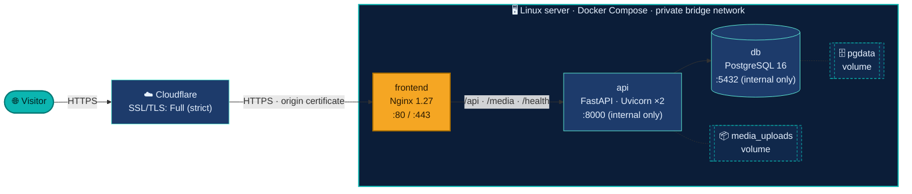

**Startup order is enforced, not hoped for:** `db` must be healthy → `api` starts → `api` must be healthy → `frontend` starts. Each container has its own healthcheck.

<details>
<summary><b>▸ First deploy, step by step</b></summary>

<br/>

```bash
# 1 · on the server: install Docker + Compose v2, then clone the repo
sudo mkdir -p /opt/tavilo && sudo chown "$USER": /opt/tavilo
git clone <your-repo-url> /opt/tavilo && cd /opt/tavilo

# 2 · create the two secret files (both are git-ignored) and lock them down
#     .env.server            → DB_USER, DB_PASSWORD, DB_NAME
#     backend/.env.production → the settings table above, with APP_ENV=production
chmod 600 .env.server backend/.env.production

# 3 · put the Cloudflare origin certificate and key where Nginx expects them
#     (/opt/tavilo/ssl/origin.pem and origin.key, mounted read-only)

# 4 · build and start — pass -f so the dev override is NOT applied
set -a && source .env.server && set +a
docker compose -f docker-compose.yml up -d --build
docker compose -f docker-compose.yml exec api alembic upgrade head

# 5 · verify
docker compose -f docker-compose.yml ps
curl -fsS http://localhost/health
```

Every release after that is one command: `bash deploy.sh` (see [workflow 7](#workflows)).

**Cloudflare:** proxy the `@` and `www` DNS records, set SSL/TLS to **Full (strict)**. Nginx redirects `www` to the apex domain and plain HTTP to HTTPS.

</details>

### ✅ Production checklist

| | Practice | Where it lives |
|:-:|---|---|
| ✅ | Secrets in git-ignored env files, `chmod 600`, never in images | `.gitignore` · compose `env_file` |
| ✅ | App refuses to boot with weak or insecure production settings | `config.py` validator |
| ✅ | Database and API unreachable from the internet | compose: no published ports |
| ✅ | Non-root container user, multi-stage builds, slim base images | both Dockerfiles |
| ✅ | Healthchecks on every container; ordered startup | compose `depends_on: service_healthy` |
| ✅ | Schema owned by Alembic in production (`create_all` is dev-only) | `src/__init__.py` lifespan |
| ✅ | Persistent named volumes for data and uploads | `pgdata` · `media_uploads` |
| ✅ | Structured JSON logs to stdout for any log collector | `config.py` |
| ✅ | Immutable, long-cache static assets; no-cache SPA shell | `nginx.conf` |
| ✅ | Deploy script fails loudly and prints logs on an unhealthy release | `deploy.sh` |

---

## 📁 Project structure

```text
Tavilo-eCommerce/
├── backend/
│   ├── src/
│   │   ├── auth/ products/ categories/ vendors/ services/
│   │   ├── cart/ wishlist/ addresses/ orders/ reviews/ admin/
│   │   ├── db/               models · session · seed
│   │   ├── audit.py  mail.py  middleware.py  errors.py  config.py
│   │   └── __init__.py       FastAPI app, lifespan, router mounts
│   ├── migrations/           20 Alembic revisions
│   ├── scripts/              live-schema inspect / repair helpers
│   ├── uploads/              media store (gated, not a public mount)
│   ├── Dockerfile            multi-stage · non-root · healthcheck
│   └── pyproject.toml  requirements.txt  alembic.ini
├── frontend/
│   ├── src/                  pages · components · api · store · lib · config
│   ├── Dockerfile            Vite build → Nginx runtime
│   ├── nginx.conf            TLS · headers · gzip · proxy · SPA fallback
│   └── vite.config.js
├── docs/assets/              animated SVG diagrams used in this README
├── docker-compose.yml            production stack
├── docker-compose.override.yml   development overrides (auto-applied locally)
├── deploy.sh                     health-gated production deploy
└── DOCKER_README.md              deployment notes
```

---

<a id="roadmap"></a>

## 🗺️ Roadmap

What is **not** here yet — stated plainly:

- [ ] Automated tests (backend and frontend) and a CI pipeline
- [ ] Rate limiting on login and password-reset endpoints
- [ ] A real payment gateway (today: cash on delivery and an always-succeeds `online_mock`)
- [ ] Order-status emails and vendor notifications
- [ ] `backend/.env.example` template

---

## 👤 Author

**Suprabh Sharma** — Software Engineer Trainee · B.Tech CSE
📧 [sharmasuprabh2608@gmail.com](mailto:sharmasuprabh2608@gmail.com)

<div align="center">

<br/>

<sub>Built with FastAPI, React and a healthy fear of race conditions.</sub><br/>
<sub>If Tavilo taught you something, a ⭐ keeps it going.</sub>

</div>

<h1> DOCKER </h1>
# Tavilo — Docker & Deployment Guide

> [!IMPORTANT]
> All secret files (`backend/.env.production`, `.env.server`) are **git-ignored**. You must create them manually on the server before first deploy.

---

## Architecture

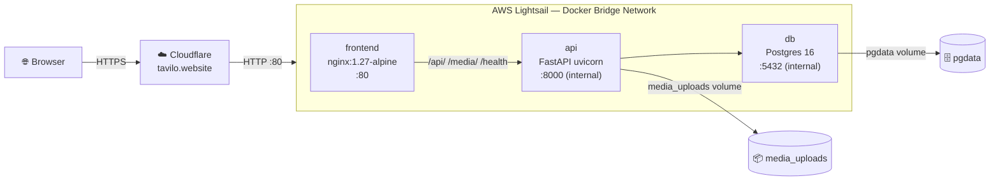

**Request flow:**
1. Browser → Cloudflare (HTTPS/443) — Cloudflare terminates TLS
2. Cloudflare → Lightsail port 80 (plain HTTP) — with `CF-Connecting-IP` header
3. nginx container → routes `/api/*` and `/media/*` → `api:8000` (internal Docker DNS)
4. All other requests → React SPA (`index.html`)

---

## Local Development

### Prerequisites
- Docker Desktop with Compose v2

### Steps

```bash
# 1. Clone
git clone <repo-url>
cd tavilo

# 2. Create local backend env (copy from example and edit)
cp backend/.env.production backend/.env   # then fill in real dev values

# 3. Create .env.server for local DB creds
cat > .env.server <<'EOF'
DB_USER=tavilo_user
DB_PASSWORD=localpassword
DB_NAME=tavilo_dev
EOF

# 4. Start everything (compose.override.yml is picked up automatically)
docker compose up

# Access:
#   Frontend Vite dev server: http://localhost:5173
#   FastAPI with hot-reload:  http://localhost:8000
#   Postgres:                 localhost:5432
```

> [!TIP]
> The override file mounts `./backend` and `./frontend` as volumes so code changes reflect instantly without rebuilding.

---

## Production Setup on AWS Lightsail

### Step 1 — SSH into the server

```bash
ssh -i ~/.ssh/lightsail-key.pem ubuntu@13.201.122.25
```

### Step 2 — Install Docker & Docker Compose

```bash
# Update packages
sudo apt-get update && sudo apt-get upgrade -y

# Install Docker
curl -fsSL https://get.docker.com | sudo sh
sudo usermod -aG docker $USER
newgrp docker

# Verify
docker --version
docker compose version   # must be v2.x
```

### Step 3 — Clone the repository

```bash
sudo mkdir -p /opt/tavilo
sudo chown $USER:$USER /opt/tavilo
git clone <your-repo-url> /opt/tavilo
cd /opt/tavilo
```

### Step 4 — Populate secret files

#### `.env.server` (DB credentials)
```bash
cat > /opt/tavilo/.env.server <<'EOF'
DB_USER=tavilo_user
DB_PASSWORD=<strong-random-password>
DB_NAME=tavilo_prod
EOF
chmod 600 /opt/tavilo/.env.server
```

#### `backend/.env.production`
```bash
# Generate secrets first
python3 -c "import secrets; print(secrets.token_hex(32))"  # → JWT_SECRET
python3 -c "import secrets; print(secrets.token_urlsafe(24))"  # → ADMIN_BOOTSTRAP_PASSWORD

nano /opt/tavilo/backend/.env.production
# Fill in all CHANGE_ME values
chmod 600 /opt/tavilo/backend/.env.production
```

> [!CAUTION]
> Never use weak passwords. `JWT_SECRET` must be at least 32 random characters. Use the `secrets` commands above.

### Step 5 — First deploy

```bash
cd /opt/tavilo

# Load DB env for compose
set -a && source .env.server && set +a

# Build and start all services
docker compose up -d --build

# Run migrations once DB is healthy
docker compose exec api alembic upgrade head

# Check everything is running
docker compose ps
```

### Step 6 — Verify

```bash
curl http://localhost/health        # should return {"status":"ok"}
curl http://localhost/api/v1/...    # your API endpoints
```

---

## Cloudflare DNS & SSL Setup

### DNS Records (in Cloudflare dashboard)

| Type | Name | Content | Proxy |
|------|------|---------|-------|
| A | `@` (tavilo.website) | `13.201.122.25` | ✅ ON |
| A | `www` | `13.201.122.25` | ✅ ON |

### SSL/TLS Settings

1. Go to **SSL/TLS** → **Overview**
2. Set mode to **Full (strict)**

> [!NOTE]
> With Cloudflare in **Full (strict)** mode, the browser sees HTTPS, so `COOKIE_SECURE=true` works correctly even though traffic between Cloudflare and your server is plain HTTP on port 80. Your nginx container does **not** need to handle TLS.

### Page Rules (optional but recommended)

- `http://tavilo.website/*` → **Always Use HTTPS**
- `http://www.tavilo.website/*` → **Always Use HTTPS**

---

## Continuous Deployment

### Using `deploy.sh`

```bash
# On the server, make it executable once:
chmod +x /opt/tavilo/deploy.sh

# Then deploy any time:
/opt/tavilo/deploy.sh
```

The script:
1. Pulls latest code from `main`
2. Rebuilds Docker images (with `--pull` to get base image updates)
3. Restarts containers with zero-downtime rolling update
4. Waits for API health check to pass
5. Runs Alembic migrations automatically
6. Prunes dangling images

### Automating with GitHub Actions (optional)

```yaml
# .github/workflows/deploy.yml
name: Deploy
on:
  push:
    branches: [main]
jobs:
  deploy:
    runs-on: ubuntu-latest
    steps:
      - name: SSH Deploy
        uses: appleboy/ssh-action@v1
        with:
          host: 13.201.122.25
          username: ubuntu
          key: ${{ secrets.LIGHTSAIL_SSH_KEY }}
          script: /opt/tavilo/deploy.sh
```

---

## Useful Operations

### View logs

```bash
# All services
docker compose logs -f

# Specific service
docker compose logs -f api
docker compose logs -f frontend
docker compose logs -f db
```

### Restart a single service

```bash
docker compose restart api
```

### Connect to Postgres shell

```bash
source /opt/tavilo/.env.server
docker compose exec db psql -U $DB_USER -d $DB_NAME
```

### Run a one-off migration

```bash
docker compose exec api alembic upgrade head
docker compose exec api alembic history
docker compose exec api alembic current
```

### Open a Python shell inside the API container

```bash
docker compose exec api python -c "from src.database import engine; print(engine)"
```

### Backup the database

```bash
source /opt/tavilo/.env.server
docker compose exec db pg_dump -U $DB_USER $DB_NAME | gzip > tavilo_backup_$(date +%Y%m%d_%H%M%S).sql.gz
```

### Restore a backup

```bash
source /opt/tavilo/.env.server
gunzip -c tavilo_backup_YYYYMMDD_HHMMSS.sql.gz | docker compose exec -T db psql -U $DB_USER -d $DB_NAME
```

### Inspect the uploads volume

```bash
docker volume inspect tavilo_media_uploads
docker compose exec api ls -la /app/uploads/products/
```

### Scale the API (if needed in future)

```bash
docker compose up -d --scale api=3
# Note: requires a load balancer in front; update nginx upstream accordingly
```

---

## Adding a New Feature / Service

### New environment variable

1. Add to `backend/.env.production` on the server
2. Add to `backend/src/config.py` Settings class
3. Add placeholder to `backend/.env.production` in the repo (with `CHANGE_ME`)
4. Run `deploy.sh`

### New Docker service (e.g., Redis)

```yaml
# docker-compose.yml — add under services:
  redis:
    image: redis:7-alpine
    restart: always
    networks:
      - tavilo_network
    volumes:
      - redis_data:/data
    healthcheck:
      test: ["CMD", "redis-cli", "ping"]
      interval: 10s
      timeout: 5s
      retries: 3

# Add to volumes section:
volumes:
  redis_data:
```

---

## Volume & Data Persistence

| Volume | Contents | Backup strategy |
|--------|----------|-----------------|
| `pgdata` | All PostgreSQL data | pg_dump to S3 |
| `media_uploads` | Product images | Sync to S3 with `aws s3 sync` |

> [!TIP]
> Future enhancement: add a cron job or Lambda to sync `media_uploads` volume to the S3 bucket for redundancy and CDN delivery.

---

## Security Checklist

- [x] API container has **no** exposed ports — only nginx faces the internet
- [x] DB container has **no** exposed ports in production
- [x] All containers run on an **isolated bridge network** (`tavilo_network`)
- [x] Backend runs as non-root user `appuser` (UID 1001)
- [x] Secret files (`*.env.production`, `.env.server`) are git-ignored
- [x] nginx denies access to hidden files (`.env`, `.git`, etc.)
- [x] Security headers set: `X-Frame-Options`, `X-Content-Type-Options`, `X-XSS-Protection`, `Referrer-Policy`
- [x] `COOKIE_SECURE=true` + Cloudflare Full SSL = cookies always transmitted over HTTPS
- [x] `TRUSTED_HOSTS` explicitly lists allowed hostnames — no wildcard `*`
- [x] `CORS_ORIGINS` explicitly lists allowed origins — no wildcard `*`
- [ ] TODO: Enable Cloudflare WAF rules (OWASP ruleset)
- [ ] TODO: Set up Fail2ban or Cloudflare rate limiting for `/api/v1/auth/`
- [ ] TODO: Add S3 automated DB backup cron

---

## File Map

```
tavilo/
├── backend/
│   ├── Dockerfile              # Multi-stage Python 3.12 build
│   ├── .dockerignore
│   ├── .env.production         # ⚠ git-ignored, fill before deploy
│   ├── src/                    # FastAPI application
│   ├── migrations/             # Alembic migration files
│   └── alembic.ini
├── frontend/
│   ├── Dockerfile              # Multi-stage node→nginx build
│   ├── .dockerignore
│   ├── nginx.conf              # SPA + reverse-proxy config
│   └── src/                    # React + Vite source
├── docker-compose.yml          # Production services
├── docker-compose.override.yml # Local dev overrides (auto-applied)
├── .env.server                 # ⚠ git-ignored, DB creds for compose
├── deploy.sh                   # Production deploy script
└── .gitignore
```
